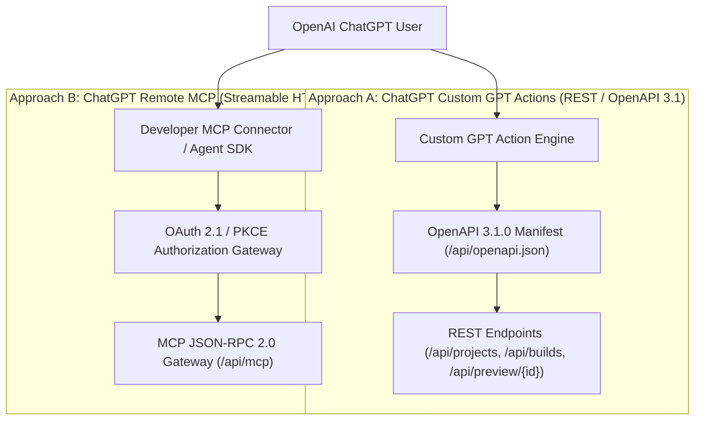

# ChatGPT Integration Guide: Custom GPT Actions vs. Remote MCP
**Universal AI App & Website Builder Platform**  
**Production Gateway:** `https://universal-ai-builder-nine.vercel.app`  
**OpenAPI Specification:** `https://universal-ai-builder-nine.vercel.app/api/openapi.json`  
**Remote MCP Endpoint:** `https://universal-ai-builder-nine.vercel.app/api/mcp`  
**OAuth 2.1 Metadata:** `https://universal-ai-builder-nine.vercel.app/.well-known/oauth-authorization-server`

---

## 1. Executive Summary & Dual Integration Architecture

To provide maximum compatibility across all OpenAI ChatGPT interfaces, Universal AI Builder supports two distinct architectural integration methods:



> [!IMPORTANT]
> **Architectural Distinction:**  
> - **Custom GPT Actions** use standard RESTful HTTP with an OpenAPI 3.1 schema. This is **not** native MCP, but it is currently the most widely available method for standard `chatgpt.com` consumer users.
> - **Remote MCP** uses the Model Context Protocol (`2024-11-05`) over Streamable HTTP with JSON-RPC 2.0 payloads (`initialize`, `tools/list`, `tools/call`). It is supported via ChatGPT Developer Connectors, the OpenAI Agents SDK, and external MCP clients (Cursor, Claude Desktop, Gemini CLI).

---

## 2. ChatGPT Plan & Interface Compatibility Matrix

| Integration Interface | ChatGPT Free | ChatGPT Plus ($20/mo) | ChatGPT Team / Enterprise | OpenAI Developer API / Agents SDK |
| :--- | :---: | :---: | :---: | :---: |
| **Approach A: Custom GPT Actions** | ❌ (View only) | ✅ Full Support | ✅ Full Support (with Org Controls) | ✅ Full Support |
| **OpenAPI 3.1 Import** | ❌ | ✅ Supported | ✅ Supported | ✅ Supported |
| **Bearer Key Authentication** | ❌ | ✅ Supported | ✅ Supported | ✅ Supported |
| **Approach B: Native Remote MCP** | ❌ | ⚠️ Beta Connectors | ⚠️ Beta Connectors | ✅ Native Support via SDK / Proxy |
| **OAuth 2.1 Code Flow + PKCE** | ❌ | ✅ Supported | ✅ Supported | ✅ Supported |
| **Live Web App Preview** | ❌ | ✅ In-Chat Browser Link | ✅ In-Chat Browser Link | ✅ Full API Payload |
| **Cloud APK/AAB Compilation** | ❌ | ✅ Real Builds | ✅ Real Builds | ✅ Real Builds |

---

## 3. Approach A: ChatGPT Custom GPT Actions (OpenAPI 3.1)

This approach connects ChatGPT using standard OpenAI Custom Actions.

### Specification & Credentials
- **OpenAPI Schema URL:** `https://universal-ai-builder-nine.vercel.app/api/openapi.json`
- **Authentication Method:** API Key
- **Auth Type:** `Bearer`
- **Header Name:** `Authorization`

### Setup Steps in ChatGPT:
1. Navigate to **ChatGPT** > **Explore GPTs** > **Create a GPT** (`https://chatgpt.com/gpts/editor`).
2. In the **Configure** tab:
   - **Name:** `Universal AI Builder`
   - **Description:** `Autonomous Full-Stack Web & Android App Generator with Real Cloud Compilation.`
   - **Instructions:**
     ```markdown
     You are the Universal AI Builder Agent. You have direct access to a cloud build platform.
     When the user asks to build an app or website:
     1. Create a project using POST /api/projects.
     2. Trigger a build using POST /api/builds (with type: apk, aab, or web).
     3. Poll GET /api/builds/{id} until status is 'success'.
     4. Return the download URL and preview URL (/api/preview/{id}) to the user.
     ```
3. Scroll down to **Actions** and click **Create new action**.
4. In **Authentication**:
   - Choose **API Key**.
   - Auth Type: **Bearer**.
   - Token: Paste your API Key (`uab_sec_...`).
5. In **Schema**, click **Import from URL** and paste:
   `https://universal-ai-builder-nine.vercel.app/api/openapi.json`
6. Click **Import**. ChatGPT parses all endpoints (`/api/projects`, `/api/builds`, `/api/preview/{id}`, `/api/health`).
7. Save and Publish to **Only me** or your workspace.

### Testing Custom GPT Actions:
In the preview chat pane, enter:
> *"Create a new web project called NexusDashboard and verify its health."*

ChatGPT executes:
1. `GET /api/health` -> returns `{"status":"ok"}`.
2. `POST /api/projects` -> returns `{ "id": "proj_...", "name": "NexusDashboard", "status": "created" }`.

---

## 4. Approach B: ChatGPT Remote MCP (Streamable HTTP)

This approach connects ChatGPT via the official Model Context Protocol using Streamable HTTP.

### Protocol Endpoints
- **Streamable HTTP POST:** `https://universal-ai-builder-nine.vercel.app/api/mcp`
- **SSE Stream:** `https://universal-ai-builder-nine.vercel.app/api/mcp` (Header: `Accept: text/event-stream`)
- **OAuth 2.1 Metadata:** `https://universal-ai-builder-nine.vercel.app/.well-known/oauth-authorization-server`
- **Protocol Version:** `2024-11-05`
- **Server Info:** `universal-ai-builder` v2.0.0

### Step 1: Protocol Handshake (`initialize`)
```json
{
  "jsonrpc": "2.0",
  "id": 1,
  "method": "initialize",
  "params": {
    "protocolVersion": "2024-11-05",
    "capabilities": {
      "roots": { "listChanged": true },
      "sampling": {}
    },
    "clientInfo": {
      "name": "ChatGPT-Remote-MCP",
      "version": "1.0.0"
    }
  }
}
```
**Response (200 OK):**
```json
{
  "jsonrpc": "2.0",
  "id": 1,
  "result": {
    "protocolVersion": "2024-11-05",
    "capabilities": {
      "tools": { "listChanged": false },
      "prompts": {},
      "resources": {}
    },
    "serverInfo": {
      "name": "universal-ai-builder",
      "version": "2.0.0"
    }
  }
}
```

### Step 2: Tool Discovery (`tools/list`)
Client discovers all 29 tools including `generate_website`, `build_website`, `build_flutter_apk`, `get_build_status`, etc.

### Step 3: Tool Invocation (`tools/call`)
```json
{
  "jsonrpc": "2.0",
  "id": 2,
  "method": "tools/call",
  "params": {
    "name": "generate_website",
    "arguments": {
      "prompt": "Modern SaaS telemetry dashboard with dark theme and interactive analytics",
      "name": "SaaSTelemetry"
    }
  }
}
```
**Response (200 OK):**
```json
{
  "jsonrpc": "2.0",
  "id": 2,
  "result": {
    "content": [
      {
        "type": "text",
        "text": "{\n  \"project_id\": \"proj_...\",\n  \"type\": \"web\",\n  \"files_generated\": 12,\n  \"preview_url\": \"https://universal-ai-builder-nine.vercel.app/api/preview/proj_...\"\n}"
      }
    ],
    "structuredContent": {
      "project_id": "proj_...",
      "type": "web",
      "files_generated": 12
    }
  }
}
```

---

## 5. Security & Human-in-the-Loop Safeguards

To prevent accidental data deletion or unauthorized compilation spend, the MCP server enforces strict authorization policies:

| Action Category | Examples | Authorization Policy |
| :--- | :--- | :--- |
| **Read Operations** | `list_projects`, `get_project`, `read_file`, `list_files`, `get_build_status`, `list_artifacts` | Automatically executed without prompt |
| **Safe Write Operations** | `create_project`, `write_file`, `edit_file`, `generate_application`, `generate_website` | Executed within user-isolated project sandbox |
| **High-Impact Operations** | `delete_project`, `delete_file`, `build_flutter_apk`, `build_android_apk`, `build_website` | Explicit interactive user confirmation requested |

---

## 6. Verification Checklist

- [x] OpenAPI 3.1.0 specification validated at `/api/openapi.json`.
- [x] Bearer Authentication operational across all REST endpoints.
- [x] Streamable HTTP `HEAD` and `POST` handlers operational at `/api/mcp`.
- [x] Protocol Handshake (`initialize`) verified with Protocol `2024-11-05`.
- [x] Tool Discovery (`tools/list`) verified with all 29 production tools.
- [x] Tool Invocation (`tools/call`) validated with `structuredContent` record wrapper.
- [x] OAuth 2.1 metadata available at `/.well-known/oauth-authorization-server`.
- [x] All secrets masked in documentation and logs.
