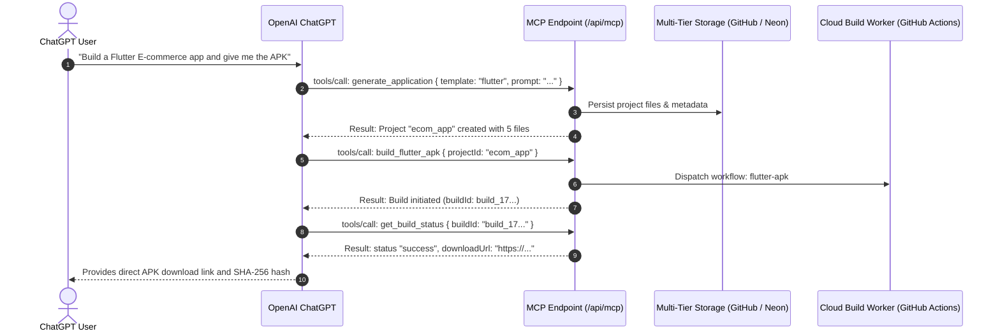

# ChatGPT MCP Integration Guide & Specification
**Universal AI App & Website Builder Platform**  
**Endpoint:** `https://universal-ai-builder-nine.vercel.app/api/mcp`  
**OAuth 2.1 Server Metadata:** `https://universal-ai-builder-nine.vercel.app/.well-known/oauth-authorization-server`

---

## 1. Overview & Architecture

Universal AI Builder provides a native, multi-transport Model Context Protocol (MCP) server designed to connect seamlessly with OpenAI ChatGPT through both **Remote MCP (Streamable HTTP / SSE)** and **Custom GPT Actions (OpenAPI / JSON-RPC gateway)**.

Through this integration, ChatGPT users can converse naturally to:
- Generate complete React, Next.js, Flutter, and native Android Kotlin applications.
- Inspect, edit, and search workspace files.
- Trigger real cloud Android compilation (`flutter build apk`, `flutter build appbundle`, `gradle assembleRelease`, `gradle bundleRelease`).
- Inspect live build logs and diagnose compilation errors.
- Retrieve signed download links for compiled APKs and AAB bundles.



---

## 2. ChatGPT Plan Compatibility Matrix

Different ChatGPT plans have distinct integration capabilities:

| Feature / Capability | ChatGPT Free | ChatGPT Plus | ChatGPT Team / Enterprise | Developer API / Custom GPTs |
| :--- | :---: | :---: | :---: | :---: |
| **Custom GPT Creation** | View Only | Full Access | Full Access with Org Controls | Full Access |
| **Custom Actions (HTTP API)** | ❌ No | ✅ Supported | ✅ Supported | ✅ Supported |
| **Bearer Token Auth** | ❌ No | ✅ Supported | ✅ Supported | ✅ Supported |
| **OAuth 2.1 Authorization Code** | ❌ No | ✅ Supported | ✅ Supported | ✅ Supported |
| **Direct Streamable MCP Client** | ❌ No | Beta / Connectors | Beta / Connectors | Supported via MCP Proxy / SDK |
| **Interactive Tool Confirmation** | N/A | Prompted per write | Configurable per org | Configurable |

> [!IMPORTANT]
> Standard consumer ChatGPT on `chatgpt.com` does not currently provide a generic raw terminal or CLI for local stdio MCP servers. Remote MCP connects either via **Custom GPT Actions** or via ChatGPT's new **Developer Connectors / MCP Plugin** interface using the HTTPS endpoint.

---

## 3. Remote MCP & Streamable HTTP Protocol Details

### Transport Endpoints
- **HTTP POST (JSON-RPC 2.0):** `https://universal-ai-builder-nine.vercel.app/api/mcp`
- **Server-Sent Events (SSE):** `https://universal-ai-builder-nine.vercel.app/api/mcp` (via `Accept: text/event-stream` or `GET`)

### Protocol Handshake (`initialize`)
ChatGPT initiates connection by exchanging client and server capabilities:

```json
{
  "jsonrpc": "2.0",
  "id": 1,
  "method": "initialize",
  "params": {
    "protocolVersion": "2024-11-05",
    "capabilities": {
      "roots": { "listChanged": true },
      "sampling": {}
    },
    "clientInfo": {
      "name": "ChatGPT-Client",
      "version": "1.0.0"
    }
  }
}
```

**Response:**
```json
{
  "jsonrpc": "2.0",
  "id": 1,
  "result": {
    "protocolVersion": "2024-11-05",
    "capabilities": {
      "tools": { "listChanged": true }
    },
    "serverInfo": {
      "name": "universal-ai-builder-mcp",
      "version": "2.0.0"
    }
  }
}
```

---

## 4. Authentication & Authorization

### Option A: Bearer API Key (Recommended for Custom GPTs)
Pass the authorization token in the HTTP header:
```http
Authorization: Bearer uab_live_...
```

### Option B: OAuth 2.1 Authorization Code Flow
For enterprise ChatGPT installations requiring per-user interactive authorization:
1. **Metadata Endpoint:** `https://universal-ai-builder-nine.vercel.app/.well-known/oauth-authorization-server`
2. **Authorization Endpoint:** `https://universal-ai-builder-nine.vercel.app/api/auth/authorize`
3. **Token Endpoint:** `https://universal-ai-builder-nine.vercel.app/api/auth/token`
4. **Supported Grant Types:** `authorization_code`, `refresh_token`
5. **Code Challenge Methods:** `S256` (PKCE required)

---

## 5. Setting Up a Custom GPT in ChatGPT

Follow these steps to connect Universal AI Builder as a dedicated Custom GPT:

### Step 1: Open GPT Editor
1. Navigate to [chatgpt.com/gpts/editor](https://chatgpt.com/gpts/editor).
2. Click **Create a GPT**.
3. In the **Configure** tab, set:
   - **Name:** `Universal App & Web Builder`
   - **Description:** `Builds full-stack websites, Flutter apps, and native Android APKs/AABs with live cloud compilation.`
   - **Instructions:**
     ```markdown
     You are the Universal App & Website Builder Agent. You have direct access to a production cloud build system through your MCP tools.
     When the user asks to create an app or website:
     1. Use `generate_application` or `generate_website` to scaffold all source code.
     2. Use `list_files` and `read_file` to review project code.
     3. Use `build_flutter_apk`, `build_flutter_aab`, `build_android_apk`, `build_android_aab`, or `build_website` to start cloud builds.
     4. Poll `get_build_status` until the build is marked 'success'.
     5. Call `download_artifact` to provide the final download link and display the SHA-256 hash to the user.
     Always ask user confirmation before deleting files or triggering production builds.
     ```

### Step 2: Configure Actions / MCP Gateway
1. Scroll down to **Actions** and click **Create new action**.
2. In the **Authentication** dropdown:
   - Select **API Key**.
   - Auth Type: **Bearer**.
   - Paste your Universal AI Builder API key (from `/dashboard/api-keys`).
3. For the Schema, import the OpenAPI / MCP gateway schema hosted at:
   `https://universal-ai-builder-nine.vercel.app/api/openapi.json`
   (Or paste the JSON-RPC action manifest).

### Step 3: Test and Publish
- Test the action by typing: *"Create a counter app in Flutter and compile the APK."*
- Click **Save** > **Publish to Only me / Anyone with link / Everyone**.

---

## 6. Write Operation Permissions & Human-in-the-Loop Controls

To prevent unintended modifications, the Universal AI Builder MCP server categorizes tools by risk profile:

| Risk Level | Tools | Security Enforcement |
| :--- | :--- | :--- |
| **Read-Only** | `list_projects`, `get_project`, `read_file`, `list_files`, `search_files`, `get_build_status`, `get_build_logs`, `list_artifacts`, `download_artifact`, `explain_project`, `analyze_project` | Automatically allowed without prompts |
| **Safe Write** | `create_project`, `clone_project`, `generate_application`, `generate_website`, `modify_application`, `install_dependencies`, `write_file`, `edit_file`, `fix_build_errors` | Executed within user's isolated project scope |
| **High-Impact Write** | `delete_project`, `delete_file`, `cancel_build`, `build_flutter_apk`, `build_flutter_aab`, `build_android_apk`, `build_android_aab`, `build_website` | Custom GPT requests explicit user confirmation button before invocation |

---

## 7. Troubleshooting & FAQs

- **Q: ChatGPT says "Could not connect to the tool"?**  
  Ensure that the Vercel deployment is active at `https://universal-ai-builder-nine.vercel.app` and that `/api/health` returns status `200 OK`.
- **Q: How long do builds take?**  
  Web builds complete in ~15-30 seconds. Flutter and Native Android APK/AAB builds complete in ~2-4 minutes on GitHub Actions runners. Instruct ChatGPT to poll every 10 seconds.
