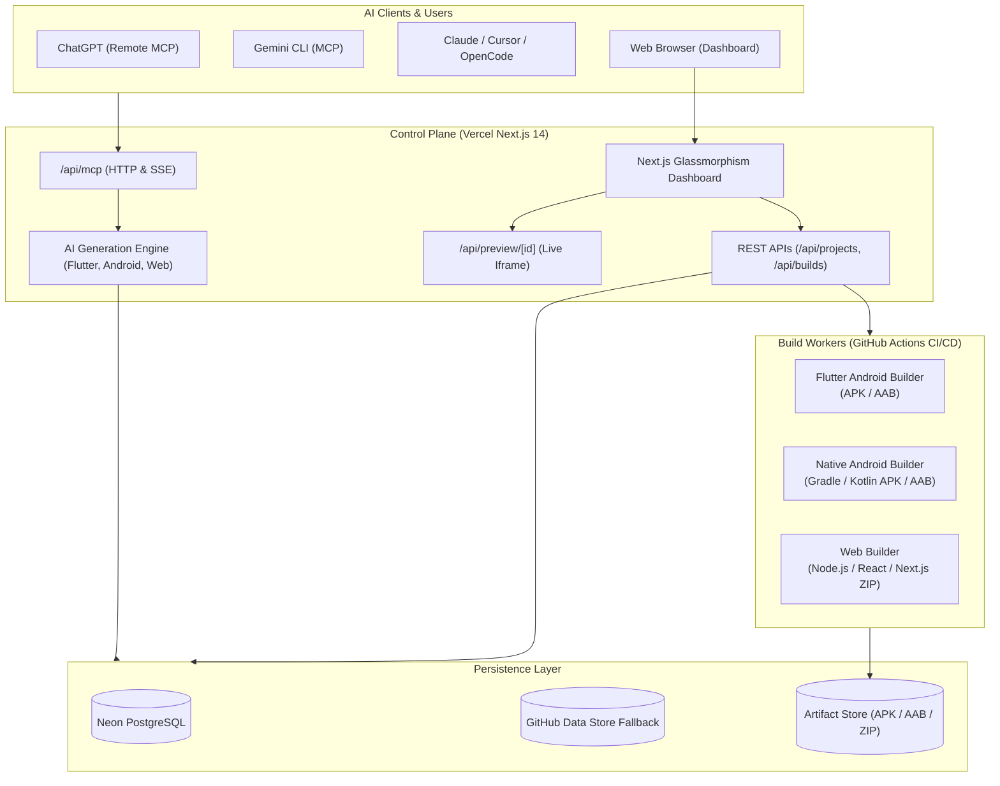
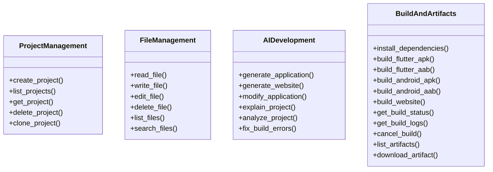

# Phase 3 Architecture: Universal AI Builder Platform

**Document Version:** 3.0.0  
**Status:** Approved Architecture

---

## 1. High-Level Architecture

The platform consists of three primary layers:
1. **Control Plane (Vercel Serverless / Next.js 14):**
   - Natural language AI code generator.
   - MCP Server (JSON-RPC 2.0 & SSE Transports) exposing 28 development tools.
   - Project, file, and build orchestrator API.
   - Live website preview renderer.
   - Modern glassmorphism dashboard UI.
2. **Persistent Storage Layer:**
   - Primary: PostgreSQL (Neon Serverless) with auto-migrated schema.
   - Resilient Fallback: GitHub Repository Data Branch Sync + Local Memory Cache.
   - Object Storage: S3-compatible / Azure Blob proxy for APKs, AABs, and ZIP artifacts.
3. **Execution & Build Worker Layer:**
   - Isolated container runners dispatched via GitHub Actions.
   - Pinned SDK images: Flutter 3.24.5, Native Android SDK 34 / JDK 17 / Kotlin 2.0, Node 20 LTS.
   - Live build monitoring and artifact packaging.

---

## 2. MCP Tool Architecture (28 Operations)

The expanded 28 MCP tools are categorized as follows:

---

## 3. Natural Language AI Code Generation Pipeline

When a user or external agent calls `generate_application` or `generate_website`:
1. **Input Analysis:** The prompt (e.g. *"Create a modern ecommerce store for minimalist clothing"*) is processed by the AI generation engine.
2. **Template & Architecture Selection:**
   - **Web:** Multi-component React application featuring responsive Tailwind CSS, Hero, Product Catalog, Shopping Cart, Checkout modal, and responsive Navigation.
   - **Flutter:** Multi-screen Flutter app featuring Material 3, State management, custom Theme, Navigation, and mock data models.
   - **Native Android:** Kotlin Android app featuring Activity, Fragments, RecyclerView, Material Components, and ViewBinding.
3. **File Tree Generation:** Generates all essential files: source code, manifests, package dependencies, asset configuration, and build scripts.
4. **Storage Sync:** Persists to the database / GitHub-backed store so files can immediately be previewed in the web browser or compiled into APK/AAB/ZIP.

---

## 4. Live Website Preview Architecture

The `/api/preview/[id]` endpoint provides instant visual feedback:
1. Queries all files for project `id` where `type == 'web'`.
2. Resolves HTML, CSS, and JS components into a self-contained rendered document with responsive styling and interactivity.
3. Serves the document with `Content-Type: text/html` under a secure sandbox policy.
4. The Dashboard embeds `/api/preview/[id]` inside an interactive browser simulator iframe (with desktop, tablet, and mobile viewport controls).

---

## 5. Security & Isolation

- **Authentication:** All MCP and REST API calls require Bearer API key authentication.
- **Authorization:** Project resources are strictly scoped to the authenticated user ID (`user_id`).
- **Container Isolation:** Every build executes in an ephemeral, single-use GitHub Actions runner container without host file access.
- **Credential Protection:** Secrets are never sent to the browser or written into generated source code files. Artifact download URLs are signed and time-limited.
