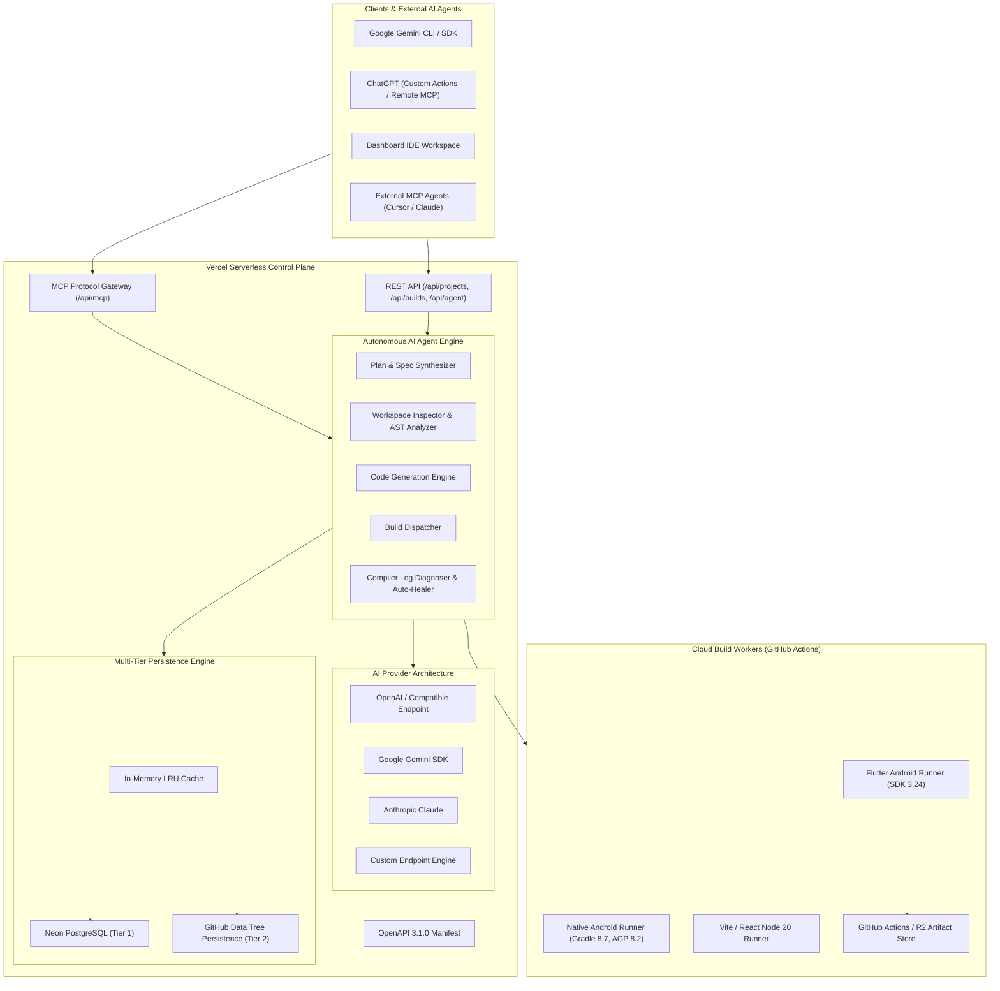
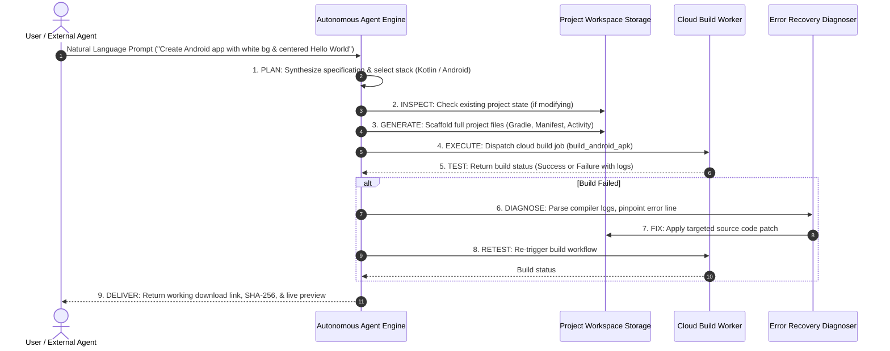

# Phase 4 Architecture: Autonomous AI Software Development Engine
**Universal AI App & Website Builder Platform**  
**Document Version:** 4.0.0  
**Status:** Approved for Implementation

---

## 1. High-Level System Architecture

---

## 2. Autonomous Agent Execution Loop

The agent executes a disciplined, bounded feedback loop with execution limits:

---

## 3. Subsystem Specifications

### Subsystem 1: Autonomous Agent Engine (`agent-engine.ts`)
- **State Machine:** `IDLE -> PLANNING -> SCAFFOLDING -> DISPATCHING -> MONITORING -> DIAGNOSING -> PATCHING -> COMPLETED / FAILED`
- **Safety Rails:**
  - `max_iterations`: Default 5, maximum 10 steps per execution.
  - `timeout_ms`: 10 minutes total execution window.
  - Path traversal checks: All file operations constrained within project root.

### Subsystem 2: Native Android Pipeline (`android-generator.ts`)
- **Structure:**
  - `settings.gradle`: Configures repository mirrors and root project name.
  - `build.gradle`: AGP 8.2.2, Kotlin 1.9.22.
  - `app/build.gradle`: Android SDK 34, minSdk 24, Java 17 compatibility.
  - `app/src/main/AndroidManifest.xml`: Configurable application label, package name, activities, permissions.
  - `app/src/main/res/values/`: `strings.xml`, `colors.xml`, `themes.xml`.
  - `app/src/main/java/{package_path}/MainActivity.kt`: Centered layouts, Jetpack Compose or View system.

### Subsystem 3: Website Builder 2.0
- **Routing & Pages:**
  - Multi-tab / multi-page responsive architecture (`Home`, `About`, `Features`, `Contact`).
  - Modular component decomposition (`Navbar`, `Footer`, `ContactForm`, `ThemeToggle`).
  - Production Vite bundling into `dist/`.

### Subsystem 4: Real-Time Project Workspace (`/dashboard/workspace`)
- **Panels:**
  - File Explorer (directory tree, file add/delete/rename).
  - Code Editor (Monaco / syntax styling, line numbers, live edit/save).
  - AI Chat & Agent Monitor (step progress, diff review with Accept/Reject).
  - Live Iframe Preview (`/api/preview/[id]`) with responsive viewport selector.
  - Build Terminal (live logs and status indicator).

### Subsystem 5: Modular AI Provider System
- Interface `AIProvider` supports streaming or standard completions.
- Providers: `OpenAICompatibleProvider`, `GeminiProvider`, `AnthropicProvider`, `CustomProvider`.
- Secure server-side environment variables: `OPENAI_API_KEY`, `GEMINI_API_KEY`, `ANTHROPIC_API_KEY`.
